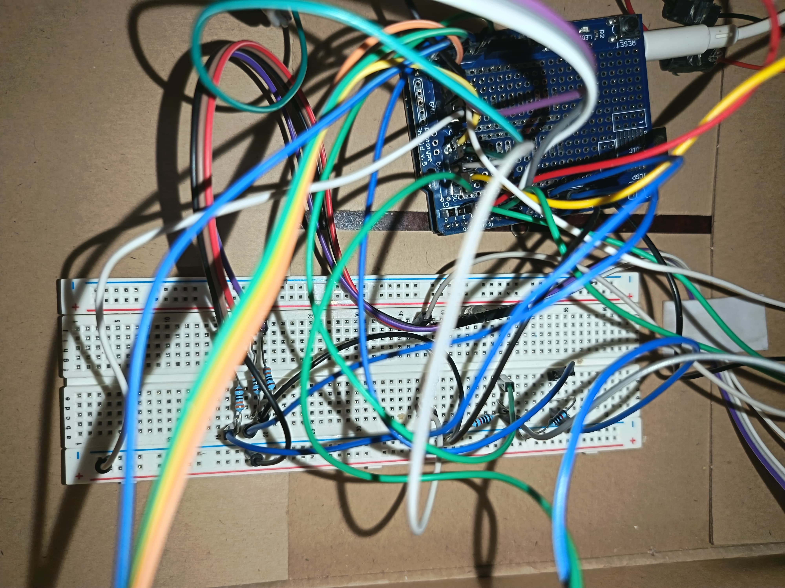
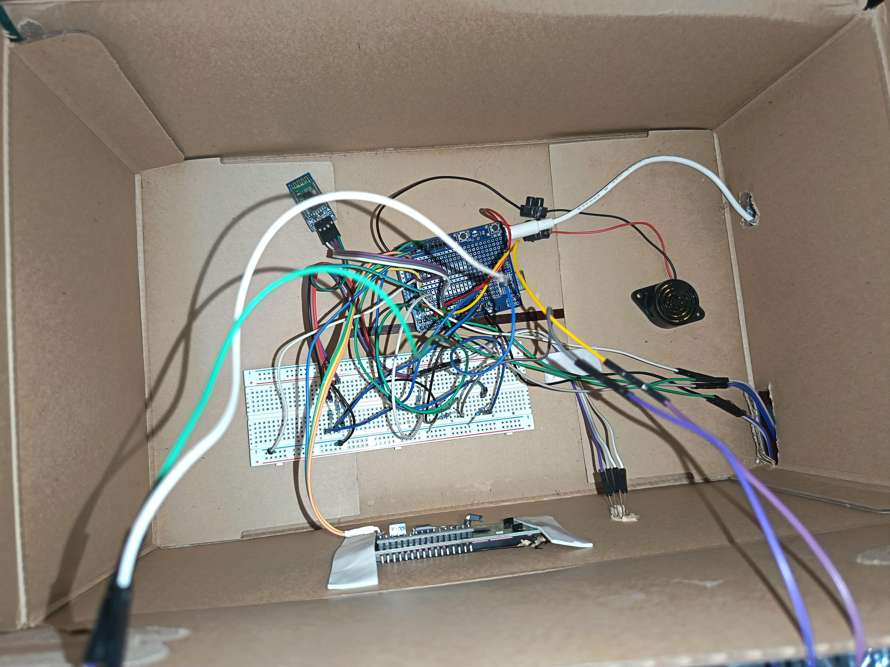

# Arduino Laser Game with Bluetooth & Target Cooldown Logic

I built this interactive laser shooting game to test target hit detection using light sensors and custom match timing. The project uses LDR sensors for hit registration, an RGB LED to display current system states, an I2C 16x2 LCD display, a buzzer for audio feedback, and Bluetooth to sync scores and remaining time with an Android app built in MIT App Inventor.

## Hardware setup
- Brain: Arduino Uno
- Detectors: LDR Light Dependent Resistors (2 Target Zones)
- Emitter: Laser Diode Module
- Indicators: RGB LED & Passive Buzzer
- Display: 16x2 LCD Display with I2C Module (Address 0x27)
- Connectivity: HC-05 Bluetooth Module (SoftwareSerial)
- Input: Physical Pushbutton Trigger

## Pinout
| Component | Arduino Pin | Function |
| :--- | :--- | :--- |
| LDR Target 1 | Analog A0 | Hit detection target 1 (+10 pts) |
| LDR Target 2 | Analog A1 | Hit detection target 2 (+20 pts) |
| Pushbutton | Digital Pin 2 | Laser trigger (INPUT_PULLUP) |
| Buzzer | Digital Pin 3 | Audio feedback and game alarms |
| Laser Module | Digital Pin 4 | Pulsed laser emitter |
| Bluetooth RX / TX | Digital Pins 6 / 5 | SoftwareSerial communication |
| RGB LED (Red) | Digital Pin 9 | Game over status indicator |
| RGB LED (Green) | Digital Pin 10 | Target hit feedback indicator |
| RGB LED (Blue) | Digital Pin 11 | Active game status indicator |
| I2C LCD | SDA / SCL (A4 / A5) | Real-time score and timer display |

## How the code works (and Anti-Spam Cooldown)
1. Target Cooldown System: To stop player score spamming from holding the laser over a sensor, the code tracks timestamps using millis() (cooldownLDR1 and cooldownLDR2) to force a mandatory 2-second delay between valid hits on each target.
2. Debounced Laser Fire: Pressing the trigger activates a 200 ms laser pulse with a 300 ms software debounce window to prevent multi-triggering.
3. Serial Bluetooth Syncing: Listens for the start command ('I') from the mobile app and streams live match telemetry over Bluetooth:
   - T:<seconds> - Remaining match time
   - P:<score> - Current match score
   - B:<target_id> - Active target hit
   - F:<final_score> - Final score when match ends

## Core logic snippet

```cpp
// Target 1 hit check with 2-second cooldown
if (analogRead(pinLDR1) > umbralLDR && millis() - cooldownLDR1 > COOLDOWN_MS) {
  cooldownLDR1 = millis();
  impacto(10, 1);
}

// Target 2 hit check with 2-second cooldown
if (analogRead(pinLDR2) > umbralLDR && millis() - cooldownLDR2 > COOLDOWN_MS) {
  cooldownLDR2 = millis();
  impacto(20, 2);
}
```

## Project photos & media






https://github.com/user-attachments/assets/2ef07936-8056-4c26-ab6a-fe918fc0240a


